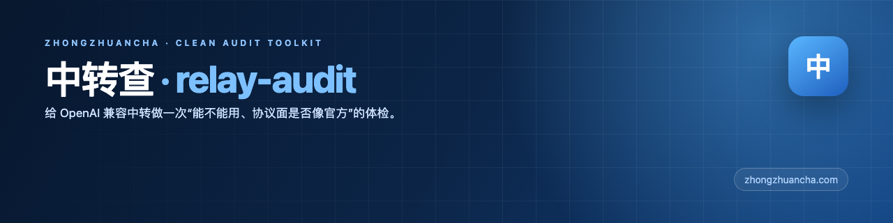
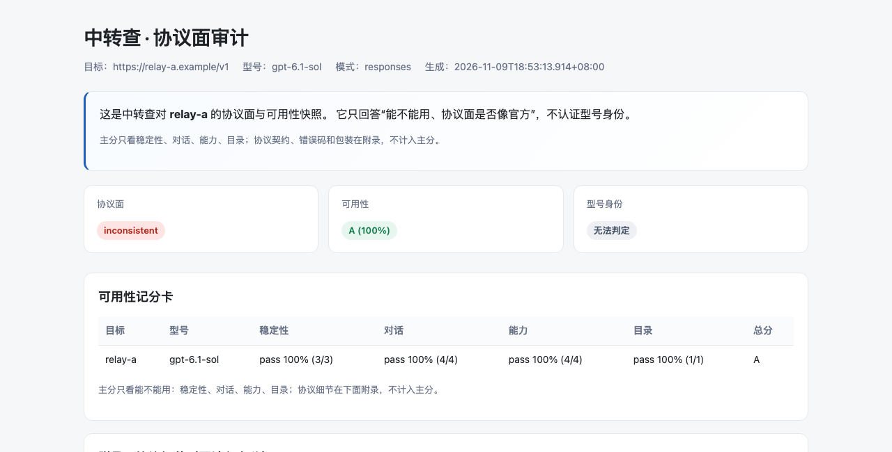
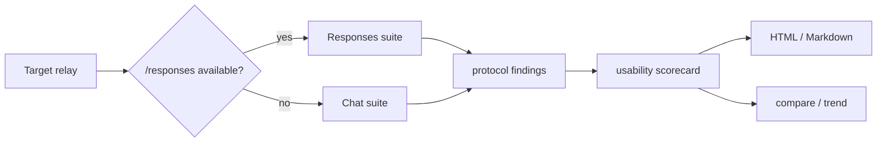

<p align="center">
  <a href="https://abcabc354.github.io/relay-audit/demo/">
    
  </a>
</p>

<h1 align="center">Zhongzhuancha · relay-audit</h1>

<p align="center">A clean audit-only toolkit for OpenAI-compatible relays: does it work, and does the protocol surface look official?</p>

<p align="center">English ｜ <a href="README.md">中文</a></p>

<p align="center">
  <a href="https://abcabc354.github.io/relay-audit/demo/"></a>
  <a href="https://github.com/abcabc354/relay-audit/releases/latest"></a>
</p>

<p align="center">
  <a href="https://www.python.org/"></a>
  <a href="docs/checks.md"></a>
  <a href="#"></a>
  <a href="LICENSE"></a>
  <a href="https://github.com/abcabc354/relay-audit/actions/workflows/ci.yml"></a>
</p>

<p align="center">
  
  
</p>

<p align="center"><em>Left: real command output. Right: report preview. Usability score, protocol appendix and check details are separate.</em></p>

## About

**Zhongzhuancha** ([zhongzhuancha.com](https://zhongzhuancha.com/)) is an AI relay directory and review site.
This repository is its **clean audit-only** toolkit: it answers “does it work, and does the protocol surface look official?” It does not authenticate model identity.

- Probes `/responses` first and falls back to Chat-only;
- main score covers stability, dialogue, capability and catalog;
- protocol contracts, error shapes and wrapper details live in the appendix;
- no API keys, evidence or real reports are bundled; the full legacy `relay_check` toolkit is not included.

If this project helps you, a Star :star: is appreciated.

## What it answers

| Answers | Does not answer |
|---|---|
| Is the Responses / Chat surface usable? | Which exact model weights are behind it |
| Do streaming, tools, structured output and vision work? | Same-family model swaps (e.g. 6-sol for 6.1-sol) |
| Is usage stable across identical requests? | Whether the provider is “official” |
| Are catalog models actually callable? | Billing, refunds or service guarantees |
| Do protocol parameters work; do error shapes look official? | — |

## Quick start

```sh
python3.11 -m venv .venv
. .venv/bin/activate
pip install relay_audit-0.1.2-py3-none-any.whl

relay-audit --base-url https://relay.example/v1 \
  --api-key-file config/relay-a.local.env \
  --out _evidence/report --enable-remote
```

Or from source:

```sh
pip install -e .
```

## Workflow



## Docs

Docs are in Chinese for now:

- [Scenarios](docs/scenarios/index.md)
- [Walkthrough](docs/walkthrough.md)
- [Checks](docs/checks.md)
- [Scoring](docs/scoring.md)
- [Architecture](docs/architecture.md)
- [FAQ](docs/faq.md)
- [Examples](docs/examples.md)
- [Roadmap](ROADMAP.md)
- [Live demo](https://abcabc354.github.io/relay-audit/demo/)

## Contributing and security

- [Contributing](.github/CONTRIBUTING.md)
- [Security Policy](.github/SECURITY.md)
- [Code of Conduct](.github/CODE_OF_CONDUCT.md)

<p align="center">
  <a href="https://github.com/abcabc354/relay-audit/graphs/contributors">
    
  </a>
</p>

## Scope

- A low score does not mean a model is fake; a high score does not prove it is genuine;
- same-family model swaps cannot be excluded;
- self-reported persona/instructions are clues, not identity evidence.

## License

MIT
