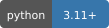
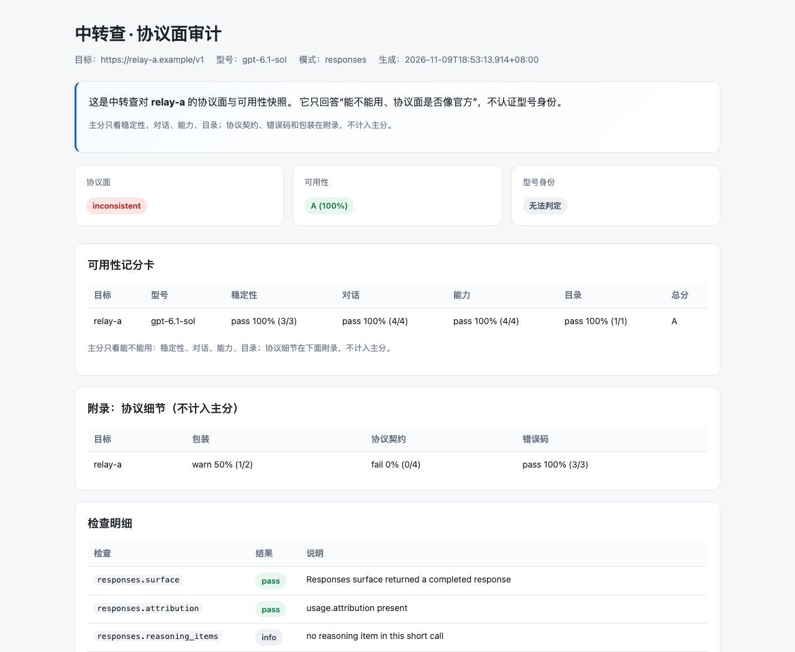
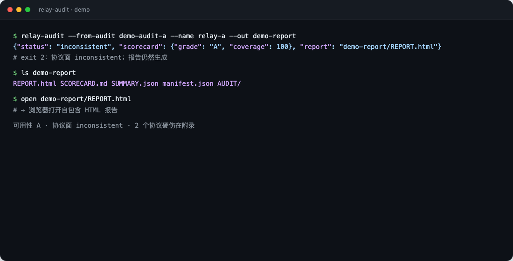
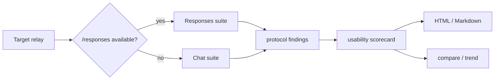

# Zhongzhuancha · relay-audit

[中文](README.md) · English

**Zhongzhuancha** ([zhongzhuancha.com](https://zhongzhuancha.com/)) is an AI relay directory and review site.
This repository is its **clean audit-only toolkit**: it checks whether an OpenAI-compatible relay works and whether its protocol surface looks like the official one.

> It does not authenticate model identity and does not claim a model is “real” or “fake”. It separates protocol, capability, catalog and stability so you can inspect them.

[Website](https://zhongzhuancha.com/) · [Live demo](https://abcabc354.github.io/relay-audit/demo/) · [Install](#install) · [Commands](#commands) · [Report](#report) · [Security](.github/SECURITY.md)

[](https://www.python.org/) [](#protocol-auto-detection) [](#) [](LICENSE) [](https://github.com/abcabc354/relay-audit/actions/workflows/ci.yml)



*Report preview: the usability score, protocol appendix and check details are shown separately.*

## Commands

| Command | Purpose |
|---|---|
| `relay-audit` | one audit, scorecard, HTML/Markdown report |
| `relay-audit-compare` | compare multiple audit snapshots |
| `relay-audit-trend` | historical trend for one target |
| `relay-inspect` | config-driven daily inspection |

## Install

```sh
python3.11 -m venv .venv-audit
. .venv-audit/bin/activate
pip install relay_audit-0.1.2-py3-none-any.whl
```

Or from source:

```sh
pip install -e .
```

## Quick start

```sh
relay-audit --base-url https://relay.example/v1 \
  --api-key-file config/relay-a.local.env \
  --out _evidence/report --enable-remote

# re-render a report from existing evidence, no requests
relay-audit --from-audit _evidence/audit-xxx --out _evidence/report-2
```

## Terminal demo



*Real command output. Exit code 2 means the protocol surface is inconsistent; the report is still generated.*

## Protocol auto-detection

The tool probes `/responses` first:

- available → Responses suite;
- unavailable → automatic Chat fallback.



## Report

Each audit directory contains:

- `REPORT.html` — self-contained HTML;
- `REPORT.md`;
- `SCORECARD.md/.json`;
- `SUMMARY.json`;
- `AUDIT/` evidence and `manifest.json`.

The usability score covers stability, dialogue, capability and catalog. Protocol contracts, error shapes and wrapper details live in the appendix and do not change the main score.

## Scope

- No model identity authentication;
- low score does not mean a model is fake; high score does not prove it is genuine;
- same-family model swaps cannot be excluded;
- self-reported persona/instructions are clues, not identity evidence.

## Development

```sh
python3.11 -m venv .venv
. .venv/bin/activate
pip install httpx pytest
python -m pytest -q
```

## Contributing and security

- [Contributing](.github/CONTRIBUTING.md)
- [Security Policy](.github/SECURITY.md)
- [Code of Conduct](.github/CODE_OF_CONDUCT.md)

## License

MIT
