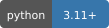
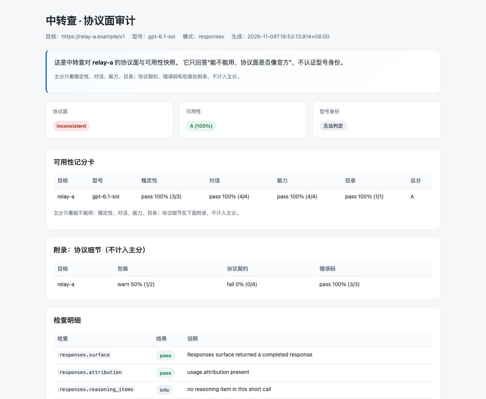
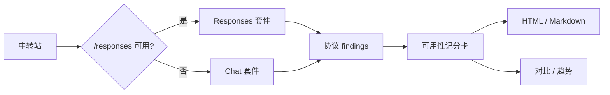

# 中转查 · relay-audit

**中转查**（[zhongzhuancha.com](https://zhongzhuancha.com/)）的 **clean audit-only** 工具：
给 OpenAI 兼容中转做一次“能不能用、协议面是否像官方”的体检。

> 这个仓库只包含审计子集，不包含完整 `relay_check` legacy 工具链，也不包含任何 API key/证据。

[网站](https://zhongzhuancha.com/) · [Live demo](https://abcabc354.github.io/relay-audit/demo/) · [安装](#安装) · [命令](#命令) · [报告](#报告) · [Security](SECURITY.md)

[](https://www.python.org/) [](#协议自适应) [](#) [](LICENSE) [](https://github.com/abcabc354/relay-audit/actions/workflows/ci.yml)



*报告预览：主分、协议附录和检查明细分开呈现。*

## 是什么

中转站常见的两个问题：

1. **能不能用**：流式、工具、结构化、视觉、长上下文是不是真的能跑；
2. **协议面像不像官方**：`instructions`、`reasoning`、`previous_response_id`、`max_output_tokens`、错误码。

这个工具把两件事分开：

- **主分**只看可用性；
- **附录**记录协议契约、错误码和包装，作为证据，不直接影响主分。

## 在线 Demo

脱敏样例，不需要安装：

- [Demo 首页](https://abcabc354.github.io/relay-audit/demo/)
- [单站报告](https://abcabc354.github.io/relay-audit/demo/report.html)
- [多站对比](https://abcabc354.github.io/relay-audit/demo/compare.html)
- [历史趋势](https://abcabc354.github.io/relay-audit/demo/trend.html)

## 命令

| 命令 | 用途 |
|---|---|
| `relay-audit` | 单站审计 + 记分卡 + HTML/Markdown |
| `relay-audit-compare` | 多目标对比 |
| `relay-audit-trend` | 同一目标历史趋势 |
| `relay-inspect` | 配置驱动的每日巡检 |

## 安装

```sh
python3.11 -m venv .venv-audit
. .venv-audit/bin/activate
pip install relay_audit-0.1.2-py3-none-any.whl
```

或从源码：

```sh
pip install -e .
```

## 快速开始

```sh
relay-audit --base-url https://relay.example/v1 \
  --api-key-file config/relay-a.local.env \
  --out _evidence/report --enable-remote

# 从已有证据重出报告，不再发请求
relay-audit --from-audit _evidence/audit-xxx --out _evidence/report-2
```

## 协议自适应

先探 `/responses`：

- 可用 → Responses 套件；
- 不可用 → 自动回退 Chat 套件。



## 报告

每个审计目录包含：

- `REPORT.html`：自包含 HTML；
- `REPORT.md`；
- `SCORECARD.md/.json`；
- `SUMMARY.json`；
- `AUDIT/` 证据与 `manifest.json`。

可用性主分：稳定性 / 对话 / 能力 / 目录；协议契约、错误码、包装在附录。

## 边界

- 不认证型号身份，不判断“真假”；
- 低分不等于型号假，高分也不等于型号真；
- 同门型号替换无法排除；
- 自报、persona、instructions 只能当线索。

## 开发

```sh
python3.11 -m venv .venv
. .venv/bin/activate
pip install httpx pytest
python -m pytest -q
```

## License

MIT
